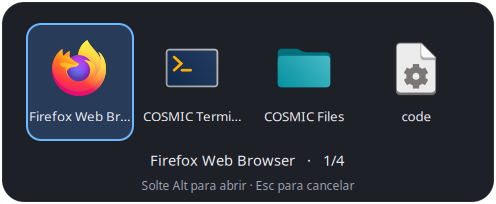

# COSMIC App Switcher

Um seletor visual de aplicativos para o COSMIC Desktop, com interação semelhante
ao Alt+Tab do GNOME: uma entrada por aplicativo, navegação enquanto Alt está
pressionado e confirmação ao soltar a tecla.



## Atalhos

| Atalho | Ação |
| --- | --- |
| Alt+Tab | Abrir o painel e selecionar o próximo aplicativo |
| Alt+Shift+Tab | Selecionar o aplicativo anterior |
| Soltar Alt | Ativar o aplicativo selecionado |
| Esc | Cancelar sem trocar de aplicativo |
| Enter | Confirmar a seleção |
| Setas esquerda/direita | Navegar no painel |
| Mover o mouse sobre um ícone | Destacar o aplicativo sem ativá-lo |
| Clique esquerdo em um ícone | Ativar o aplicativo selecionado |
| Roda do mouse | Percorrer os aplicativos |
| Alt+crase | Alternar entre janelas do aplicativo atual |
| Alt+Shift+crase | Percorrer as janelas do aplicativo atual no sentido inverso |

Várias janelas do mesmo aplicativo aparecem como uma única entrada.
O painel exibe páginas de até sete ícones. As posições ficam estáveis enquanto
você escolhe com o mouse. Você pode mover o mouse para um ícone e soltar Alt,
ou confirmar com um clique. Um cursor parado não altera a seleção ao abrir o
painel. Janelas minimizadas são restauradas ao serem escolhidas.

A ordem do painel segue os **aplicativos usados mais recentemente**: o atual
fica primeiro e um Alt+Tab rápido volta ao anterior. Pressionar novamente
alterna entre os dois últimos. A ordem fica congelada enquanto o painel está
aberto, para você percorrer a lista sem que os ícones mudem de lugar.

## Requisitos

- COSMIC Desktop em Wayland; desenvolvido e usado no Pop!_OS 24.04.
- Protocolos COSMIC de informação/gerenciamento de janelas e layer-shell.
- Compilador C, Make, pkg-config e arquivos de desenvolvimento do Wayland.
- Python 3, PyGObject com GTK 3 e Pycairo.

No Pop!_OS/Ubuntu, instale as dependências:

```bash
sudo apt install build-essential pkg-config libwayland-dev libwayland-bin \
  python3 python3-gi python3-cairo gir1.2-gtk-3.0
```

## Instalação

```bash
git clone https://github.com/lcoutinhom/cosmic-app-switcher.git
cd cosmic-app-switcher
bash ./install-visual.sh
```

Execute o instalador como seu usuário, sem sudo. Ele compila o programa,
preserva uma cópia dos atalhos anteriores e configura os atalhos do seletor.
O COSMIC normalmente recarrega os atalhos sem precisar sair da sessão.

O binário mantém o nome `cosmic-cycle-app` para compatibilidade com o projeto
de origem. Os arquivos instalados são:

| Caminho | Conteúdo |
| --- | --- |
| `~/.local/bin/cosmic-cycle-app` | Binário |
| `~/.local/lib/cosmic-cycle-app/` | Renderizador e indicador opcional |
| `~/.config/cosmic/com.system76.CosmicSettings.Shortcuts/v1/custom` | Bloco de atalhos |
| `~/.local/state/cosmic-cycle-app/` | Backup dos atalhos/binário e checksum |
| `~/.local/state/cosmic-app-switcher/` | Backup dos auxiliares visuais |
| `~/.config/autostart/cosmic-app-switcher-focus.desktop` | Monitor de foco no início da sessão |

Os caminhos de binário, configuração e estado respeitam `XDG_BIN_HOME`,
`XDG_CONFIG_HOME` e `XDG_STATE_HOME`. Os auxiliares Python usam o diretório
`~/.local/lib/cosmic-cycle-app/`. A instalação não altera os demais atalhos.
Para layouts US internacional, o instalador adapta a tecla de crase para
`dead_grave`/`dead_tilde`.

Um monitor leve registra as mudanças reais de foco, incluindo cliques e
Alt+crase. Ele inicia no login ou no primeiro uso do Alt+Tab, sem root ou
serviço de sistema. O histórico contém apenas identificadores de aplicativos
na sessão atual, dentro de `$XDG_RUNTIME_DIR`, e não grava títulos ou teclas.
Eventos de notificação sem ativação não mudam a ordem. O histórico anterior à
primeira execução não pode ser reconstruído; aplicativos ainda não observados
ficam no fim da lista. Ao sair da sessão, o monitor encerra e o histórico é
descartado com o diretório de runtime.

## Desinstalação

```bash
bash ./uninstall-visual.sh
```

Remove os atalhos gerenciados e restaura arquivos que existiam antes da
instalação, preservando outros atalhos criados depois. Se você alterou um
arquivo instalado, o desinstalador recusa sobrescrevê-lo silenciosamente.

Para restaurar a cópia exata anterior, descartando mudanças posteriores no
arquivo de atalhos:

```bash
bash ./uninstall-visual.sh --restore-backup
```

## Outros modos

```bash
# Troca imediata entre aplicativos, sem painel.
cosmic-cycle-app --apps
cosmic-cycle-app --apps --reverse

# Alternância entre janelas do mesmo aplicativo.
cosmic-cycle-app
cosmic-cycle-app --reverse

# Inspecionar janelas ou a próxima seleção sem ativá-la.
cosmic-cycle-app --list
cosmic-cycle-app --apps --dry-run
```

Para configurar o Alt+Tab no modo imediato:

```bash
python3 scripts/install_visual_switcher.py --rollback
```

Para voltar ao painel visual, execute `bash ./install-visual.sh`.

## Desempenho e limites

- O painel reutiliza as imagens por até cinco minutos quando a lista e a ordem
  dos aplicativos não mudam, evitando iniciar Python/GTK a cada abertura.
  As duas últimas ordens ficam em cache para a alternância rápida entre apps.
- A primeira abertura e mudanças de aplicativos podem levar mais tempo.
- O painel usa o histórico recente de foco. O modo legado `--apps`, sem painel,
  mantém a ordem original fornecida pelo compositor.
- Agrupamento depende do `app_id`: aplicativos com o mesmo identificador
  aparecem juntos.
- A navegação por teclado foi desenvolvida com o layout US internacional.
  Outros layouts ou remapeamentos podem precisar de ajustes.
- O painel tem um limite de 128 aplicativos e cancela após 15 segundos.
- Não inclui as animações, prévias de janelas ou todas as integrações do GNOME.

## Desenvolvimento e testes

```bash
make test
```

Os testes cobrem seleção por aplicativo, avanço/retorno, teclado e mouse do painel,
cache, compatibilidade da memória compartilhada, instalação, reinstalação,
restauração e proteção contra remoção de arquivos modificados.

Um compositor Wayland de teste também verifica o protocolo do painel em
ambientes que permitem consultar credenciais de sockets. Esse teste informa
`SKIP` em ambientes restritos; os demais testes continuam sendo executados.
A integração com o COSMIC real deve ser validada na sessão gráfica.

Para gerar uma prévia estática:

```bash
python3 scripts/render_switcher.py --preview /tmp/switcher 496 204 \
  firefox com.system76.CosmicTerm com.system76.CosmicFiles code
```

A imagem será salva em `/tmp/switcher.png`.

## Créditos e licença

Baseado no [cosmic-cycle-app de muharamdani](https://github.com/muharamdani/cosmic-cycle-app),
sob licença MIT. Esta versão adiciona alternância entre aplicativos, painel
visual, captura temporária do teclado e cache. Veja [NOTICE.md](NOTICE.md),
[LICENSE](LICENSE) e [VENDORED_SOURCES.md](VENDORED_SOURCES.md).
